# 💼 joldo Portfolio — 개인 포트폴리오 웹

> Next.js + Spring Boot 기반 **관리자가 직접 글을 쓰고 고치는 포트폴리오 사이트** (개인 프로젝트)
> 이 저장소(`joldoPortfolio-web`)는 **오태흔**이 만든 포트폴리오의 **Next.js 웹 프론트엔드**이며, 백엔드는 별도 Spring Boot 서버로 분리되어 있습니다.

- **기간**: 2026.07.07 \~
- **인원**: 1명
- **저장소**: [프론트 joldoPortfolio-web](https://github.com/JOLDO/joldoPortfolio-web) / [백엔드 joldoPortfolio-server](https://github.com/JOLDO/joldoPortfolio-server)
- **배포**: 2026.07 AWS(EC2 + RDS)에 배포 → 현재는 **AWS 프리티어 기간 만료로 서버 종료**
- **담당**
  - **Frontend (Next.js)**: 원페이지 메인(소개 · 경력 · 기술 · 프로젝트 · 자격증 · 연락처), 스크롤 위치 기반 네비 강조, 프로젝트 카드 목록(가로 스크롤) · 상세 모달, **TipTap 에디터로 글 작성/수정**(이미지 드래그 · 붙여넣기 업로드), 관리자 로그인, **View Transition 페이지 전환 애니메이션**
  - **Backend (Spring Boot)**: 카테고리별 글 CRUD, 공개/비공개, 프로젝트 그룹, 자격증 CRUD, 이미지 업로드, 관리자 JWT 인증 · 권한 → [🖥 백엔드 섹션](#backend)
  - **배포**: GitHub Actions → EC2 자동 배포, Nginx 리버스 프록시, RDS(MariaDB) → [🚀 배포](#deploy)

---

<a id="screens"></a>

## 🖼 화면

### 메인 (원페이지)

| 히어로 · 네비게이션 | 기술 스택 |
|:---:|:---:|
| 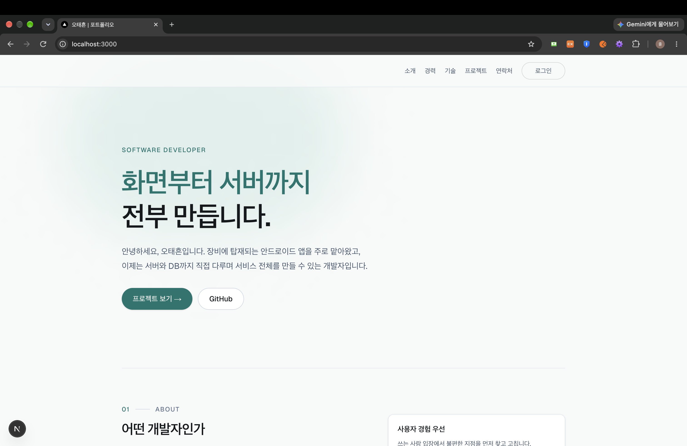 | 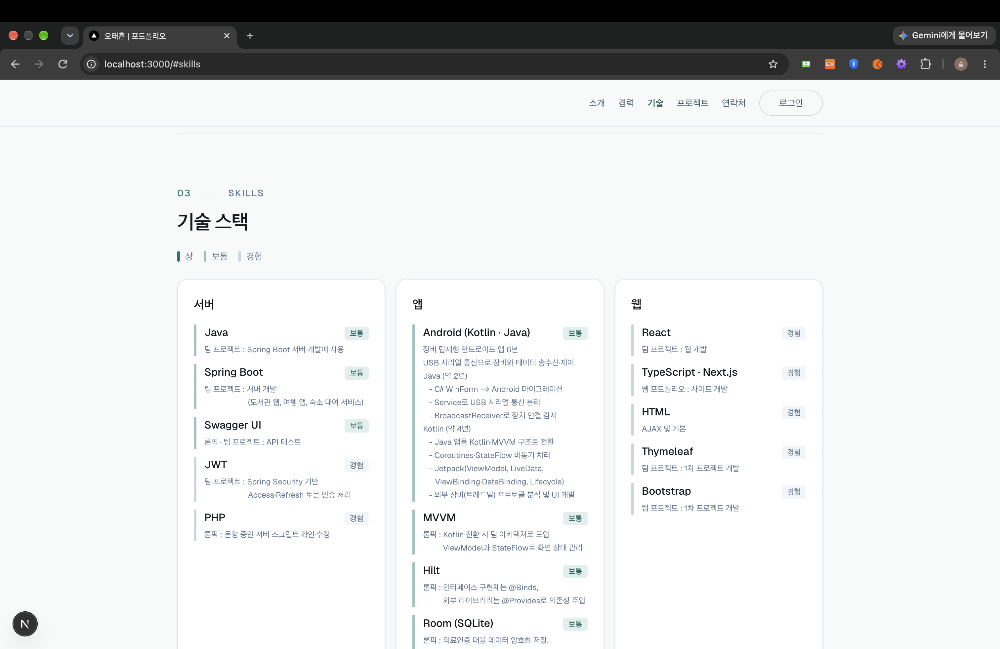 |
| 상단 고정 네비, 스크롤 위치에 따라 **현재 섹션 강조** | 분야별 카드, 숙련도(상 · 보통 · 경험)를 **왼쪽 선 색**으로 구분 + 사용 근거 표시 |

### 프로젝트

| 프로젝트 카드 목록 (가로 스크롤) | 프로젝트 상세 모달 | 상세 기록 (글) |
|:---:|:---:|:---:|
| 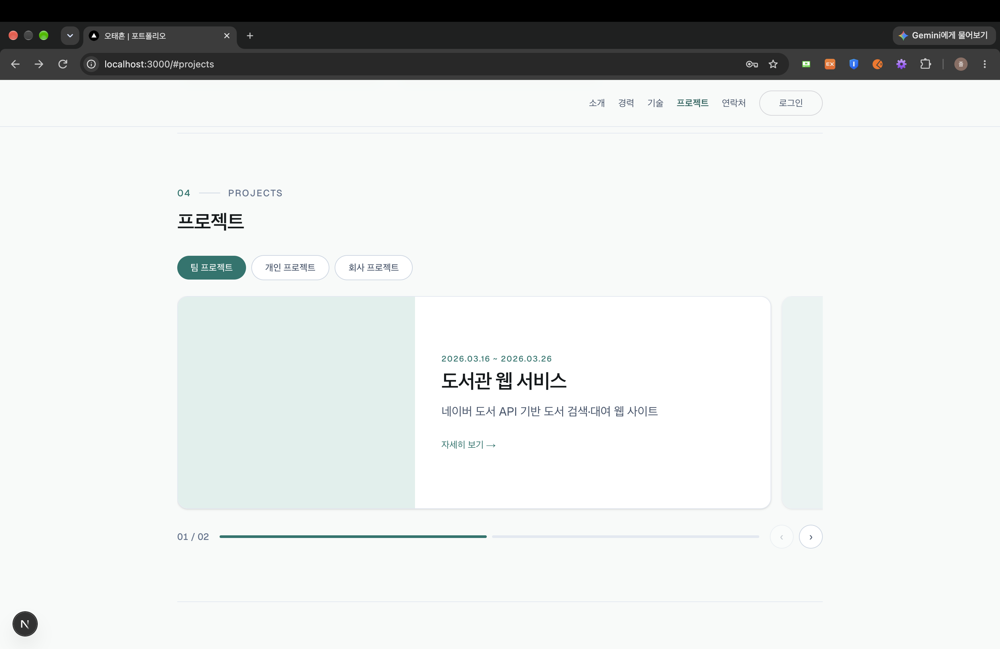 | 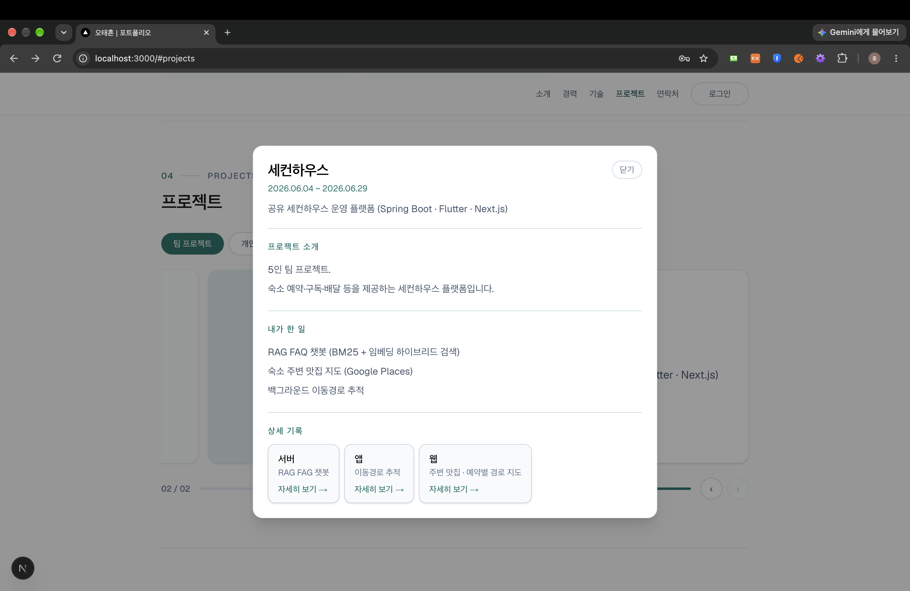 | 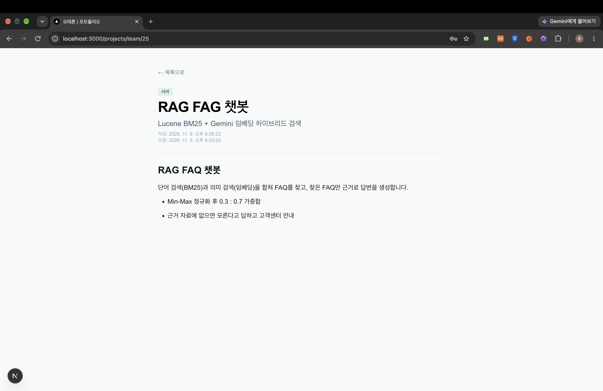 |
| 팀 / 개인 / 회사 탭, 한 장씩 넘기는 가로 스크롤 카드 + 인디케이터 | 프로젝트 소개 · 내가 한 일 · **파트별(웹/앱/서버) 상세 기록** 링크 | TipTap으로 작성한 본문을 읽기 전용으로 렌더 |

### 관리자

| 관리자 로그인 | 글 작성 · 수정 (TipTap) | 자격증 등록 |
|:---:|:---:|:---:|
| 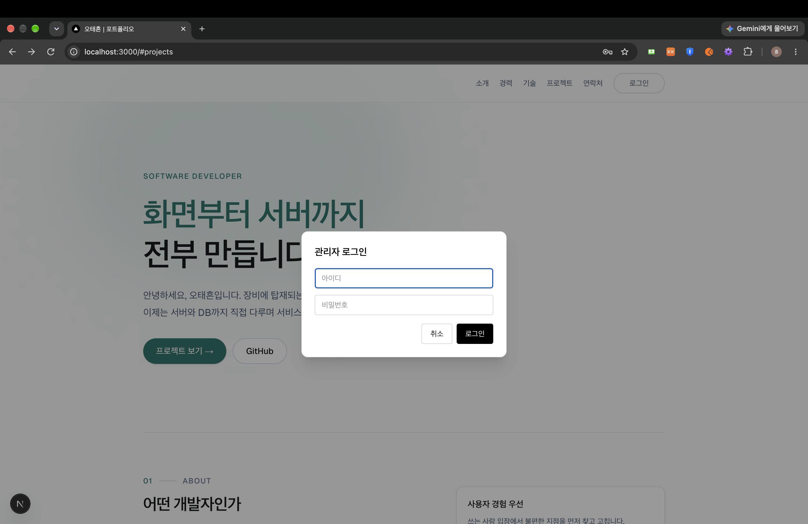 | 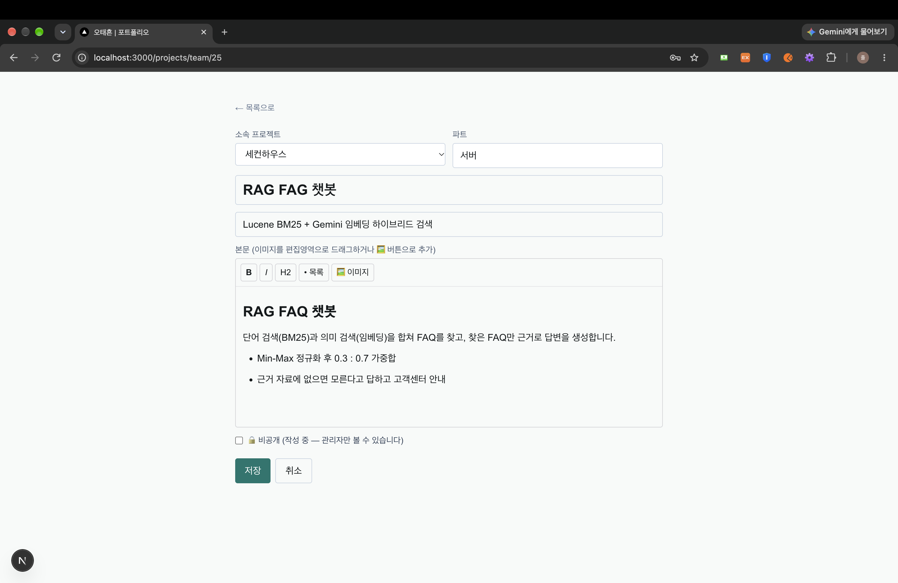 | 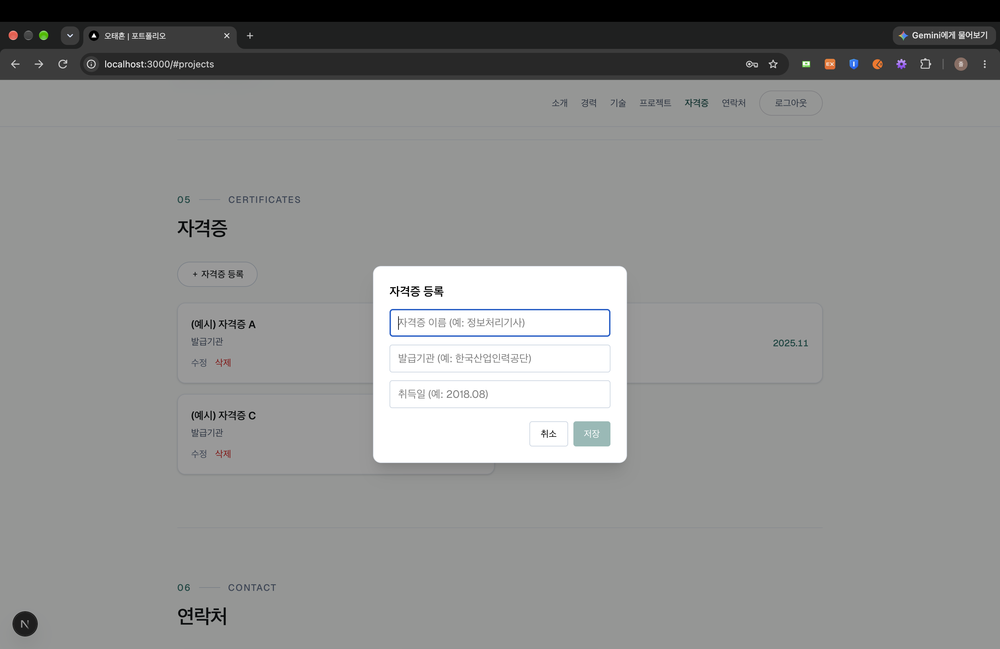 |
| `<dialog>` 모달 로그인, 로그인하면 등록 · 수정 · 삭제 버튼이 나타남 | 이미지를 **드래그 · 붙여넣기 · 버튼**으로 업로드해 원하는 위치에 삽입, 비공개(작성 중) 저장 | 모달 폼 하나로 등록과 수정을 같이 처리 |

---

## 🛠 사용 기술 (Frontend)

| 구분 | 기술 |
|------|------|
| Web | **Next.js 16** (App Router), **React 19**, TypeScript |
| 스타일 | **Tailwind CSS 4**, CSS 변수 기반 색 토큰, Geist 폰트(`next/font`) |
| 상태 관리 | **React Context** (`AuthProvider`) — 로그인 상태 / 토큰 |
| 네트워크 | **axios** (응답 인터셉터로 401 · 403 처리) |
| 인증 | JWT (localStorage) + `loggedIn` 쿠키 |
| 에디터 | **TipTap 3** (StarterKit, Image 확장) — 본문을 JSON으로 저장 |
| 애니메이션 | React `<ViewTransition>` (페이지 전환), CSS `@keyframes` (모달 등장) |
| 배포 | GitHub Actions, AWS EC2, Nginx, systemd |

---

## ✨ 담당 기능 (Frontend)

### 1. 원페이지 메인 · 스크롤 네비게이션
- 소개 · 경력 · 기술 · 프로젝트 · 자격증 · 연락처를 한 페이지에 두고, 상단 고정 네비에서 섹션으로 이동
- 화면 위에서 **40% 지점에 기준선**을 두고 그 선을 지난 마지막 섹션을 "지금 보는 섹션"으로 강조
- 마지막 섹션(연락처)은 짧아서 기준선까지 못 올라오므로 **바닥 근처에서 미리 강조**
- 좁은 화면에서는 경력 · 자격증 링크를 숨김, 자격증이 하나도 없으면 방문자에게는 섹션과 링크를 모두 숨김

### 2. 기술 스택 데이터 분리
- 기술 목록을 `skillsData.ts`에 분리해 화면 코드 수정 없이 내용만 바꿀 수 있게 함
- 숙련도를 **상 / 보통 / 경험** 3단계로 정의함

### 3. 프로젝트 (카테고리 · 그룹 · 글 3단 구조)
- **카테고리**(팀 / 개인 / 회사) → **그룹**(프로젝트 하나, 예: 1차 · 2차) → **글**(파트별 상세 기록, 예: 웹 · 앱 · 서버)
- 카테고리별 API 경로를 `projectConfig.ts` 한 곳에서 관리
- 가로 스크롤 카드 목록: 카드 폭을 92%로 잡아 **다음 장이 살짝 걸쳐 보이게** 하고, 화면 중앙에 가장 가까운 카드를 현재 카드로 계산
- 카드를 누르면 `<dialog>` 모달로 상세 표시, **세로로 긴 썸네일은 칸을 세로형으로 바꿔** 덜 잘리게 함

### 4. 관리자 로그인 · 인증
- `AuthProvider`(Context)에서 로그인 상태와 `login` / `logout` / `getToken`을 앱 전체에 제공
- 서버 컴포넌트인 `layout.tsx`가 **쿠키(`loggedIn`)를 먼저 읽어** 초기 상태로 전달 → 첫 화면 로그인 버튼 깜빡임 방지
- axios 응답 인터셉터: 토큰을 실어 보낸 요청이 **401 · 403이면 자동 로그아웃** 후 메인으로 이동
- 로그인하면 비공개 글 · 그룹까지 불러오고, 등록 · 수정 · 삭제 버튼과 "전체 보기"(관리자 목록)가 나타남

### 5. TipTap 에디터 · 이미지 업로드
- 툴바: 굵게 · 기울임 · H2 · 목록 · 이미지
- 이미지는 **드래그 앤 드롭**, **붙여넣기**(커서 위치), **버튼 선택** 세 가지로 업로드
- 글마다 **비공개(작성 중)** 체크 → 관리자에게만 보이고 🔒 배지 표시

### 6. 화면 전환 애니메이션
- `next.config.ts`에서 `experimental.viewTransition`을 켜고, 레이아웃 전체를 `<ViewTransition default="page-fade-slide">`로 감싸 **페이지 전환 시 페이드 + 슬라이드**
- 모달은 `modal-pop` 클래스로 **배경 dim + 아래에서 올라오는 등장 애니메이션**

---

## 🔄 화면 흐름

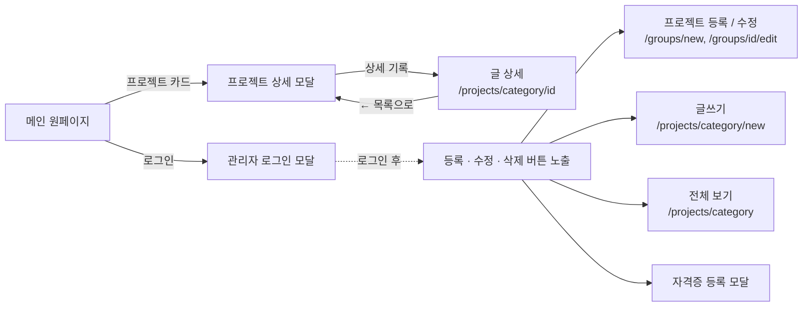

## 🏗 구조 (Next.js)

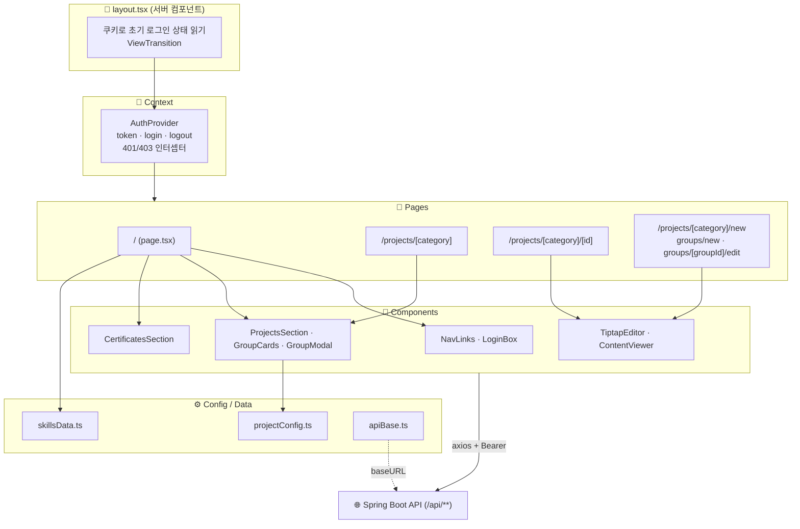

## 🐛 트러블슈팅 (Frontend)

| 문제 | 원인 | 해결 |
|------|------|------|
| 위로 스크롤할 때 네비가 "프로젝트"를 건너뛰고 "기술"을 강조함 | IntersectionObserver 이벤트가 경계에서 몰리면 가운데 섹션이 씹힘 | 스크롤마다 **기준선(40%) 위치를 직접 계산**하는 방식으로 변경 |
| 이미지를 연달아 넣으면 앞 이미지가 교체됨 | 삽입 직후 이미지가 선택된 상태로 남음 | 이미지 뒤에 **빈 문단을 함께 삽입**해 커서를 다음 줄로 이동 |

<a id="backend"></a>

## 🖥 백엔드 (Spring Boot)

> 포트폴리오의 **글 · 프로젝트 그룹 · 자격증 · 이미지 · 관리자 인증**을 담당하는 REST API 서버
> 백엔드 저장소: [joldoPortfolio-server](https://github.com/JOLDO/joldoPortfolio-server)

### 🛠 사용 기술 (Backend)

| 구분 | 기술 |
|------|------|
| Backend | Java 17, Spring Boot 4.1 |
| ORM | Spring Data JPA (Hibernate) — 쿼리 메서드 방식 |
| 인증 | Spring Security + **JWT** (jjwt 0.12, HS256) |
| Database | MariaDB |
| API 문서 | Swagger (springdoc-openapi 3.0) |
| 배포 | AWS EC2 · RDS(MariaDB) · Nginx · systemd · GitHub Actions |
| 기타 | Lombok, Gradle |

### ✨ 담당 기능 (Backend)

#### 1. 카테고리별 프로젝트 글 CRUD
- 카테고리는 요청 body가 아니라 **URL 경로에서 받아 저장**
- 본문은 TipTap 에디터의 **JSON 문서를 문자열 그대로 LONGTEXT에 저장** (서버는 내용을 해석하지 않음)
- 목록 응답은 본문을 뺀 가벼운 DTO, 상세에서만 본문 포함

#### 2. 자격증 CRUD
- 이름 · 발급기관 · 취득일, 취득일은 문자열로 저장하고 그 값으로 최신순 정렬

#### 3. 이미지 업로드
- 파일명은 **UUID**로 바꿔 중복 방지

### 🔐 인증 · 권한 흐름

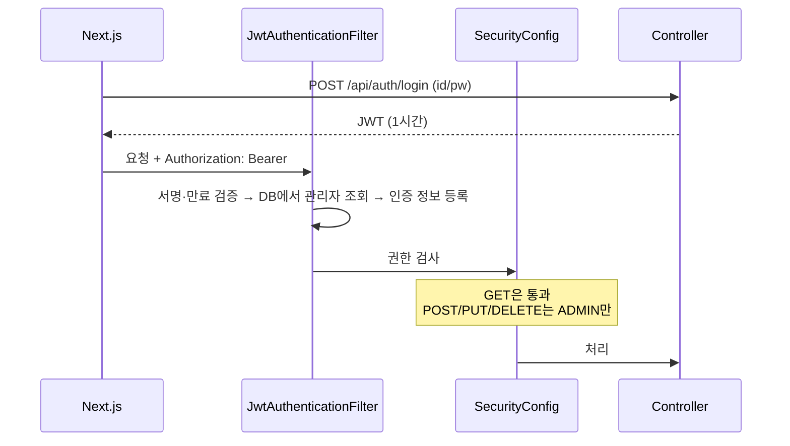

<a id="upload-flow"></a>

### 🖼 이미지 업로드 흐름

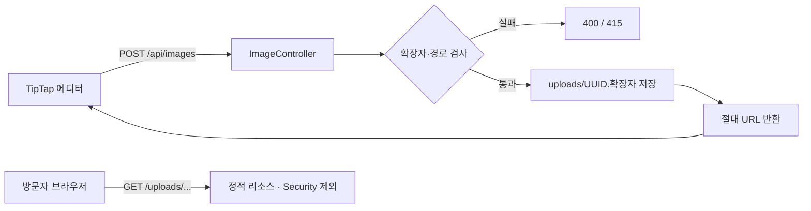

### 🗄 DB 관계

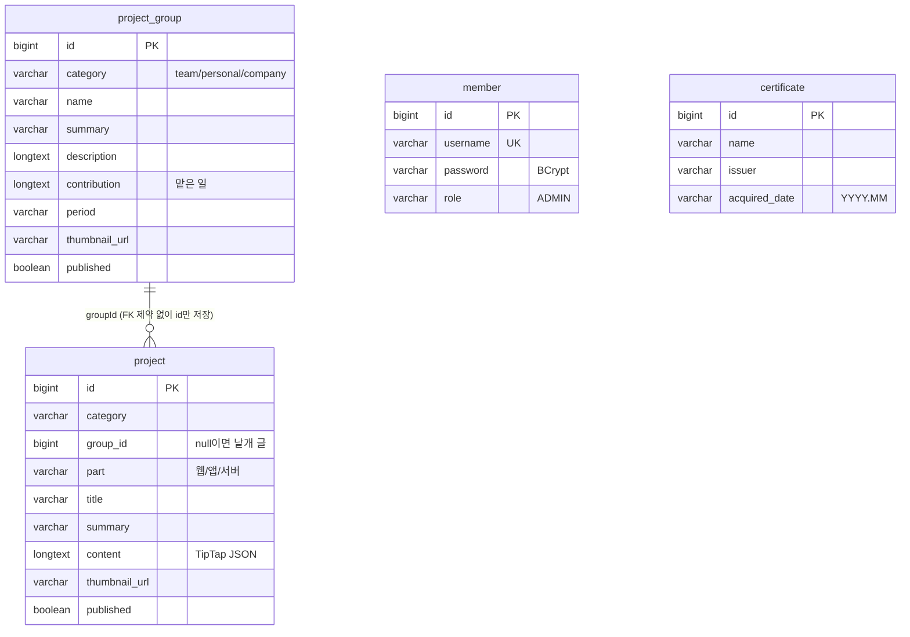

- 모든 테이블에 `created_at` / `updated_at`이 있고 `@PrePersist` · `@PreUpdate`로 자동 기록
- 그룹과 글은 FK 제약 없이 **id만 저장** → 그룹을 지워도 글은 남고 `group_id`만 비워짐

## 🚀 배포

> 2026.07 AWS에 배포했으나, 현재는 **AWS 프리티어 기간 만료로 서버 종료**

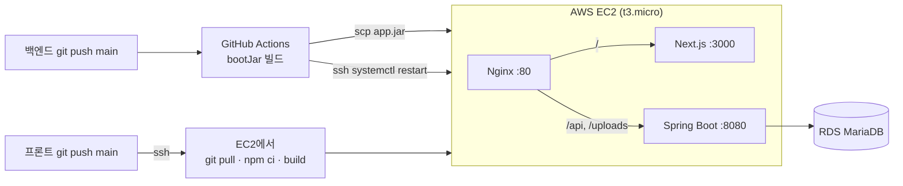

---

## ▶ 실행 방법

### 백엔드

```bash
git clone https://github.com/JOLDO/joldoPortfolio-server
cd joldoPortfolio-server
# 1. MariaDB 준비 (기본: localhost:3308 / portfolio-db) — application.properties에서 변경 가능
# 2. src/main/resources/application-secret.properties.example → application-secret.properties 복사 후 입력
#    spring.datasource.username / password, app.admin.username / password, app.jwt.secret(32자 이상)
# 3. 실행 (첫 실행 시 관리자 계정 자동 생성, 테이블은 ddl-auto=update로 자동 생성)
./gradlew bootRun
# Swagger: http://localhost:8080/swagger-ui.html
```

### 웹 (Next.js)

```bash
# 1. 백엔드 주소 설정 (.env* 파일은 git에 올라가지 않음)
echo "NEXT_PUBLIC_API_BASE=http://localhost:8080" > .env.development
# 2. 실행
npm install
npm run dev   # http://localhost:3000
```
