# 💼 joldo Portfolio — 개인 포트폴리오 웹

> Next.js + Spring Boot 기반 **관리자가 직접 글을 쓰고 고치는 포트폴리오 사이트** (개인 프로젝트)
> 이 저장소(`joldoPortfolio-web`)는 **오태흔**이 만든 포트폴리오의 **Next.js 웹 프론트엔드**이며, 백엔드는 별도 Spring Boot 서버로 분리되어 있습니다.

- **기간**: 2026.07.07 \~ 2026.10.19
- **인원**: 1명
- **저장소**: [프론트 joldoPortfolio-web](https://github.com/JOLDO/joldoPortfolio-web) / [백엔드 joldoPortfolio-server](https://github.com/JOLDO/joldoPortfolio-server)
- **배포**: 2026.07 AWS(EC2 + RDS)에 배포 → 현재는 **AWS 프리티어 기간 만료로 서버 종료**
- **담당**
  - **Frontend (Next.js)**: 원페이지 메인(소개 · 경력 · 기술 · 프로젝트 · 자격증 · 연락처), 스크롤 위치 기반 네비 강조, 프로젝트 카드 목록(가로 스크롤) · 상세 모달, **TipTap 에디터로 글 작성/수정**(이미지 드래그 · 붙여넣기 업로드), 관리자 로그인 · JWT 만료 자동 로그아웃, **View Transition 페이지 전환 애니메이션**
  - **Backend (Spring Boot)**: 카테고리별 글 CRUD(컨트롤러 하나로 3종 처리), 공개/비공개, 프로젝트 그룹, 자격증 CRUD, 이미지 업로드(경로 조작 방지), 관리자 JWT 인증 · 권한 → [🖥 백엔드 섹션](#backend)
  - **배포**: GitHub Actions → EC2 자동 배포, Nginx 리버스 프록시, RDS(MariaDB) → [🚀 배포](#deploy)

---

<a id="screens"></a>

## 🖼 화면

### 메인 (원페이지)

| 히어로 · 네비게이션 | 기술 스택 |
|:---:|:---:|
| 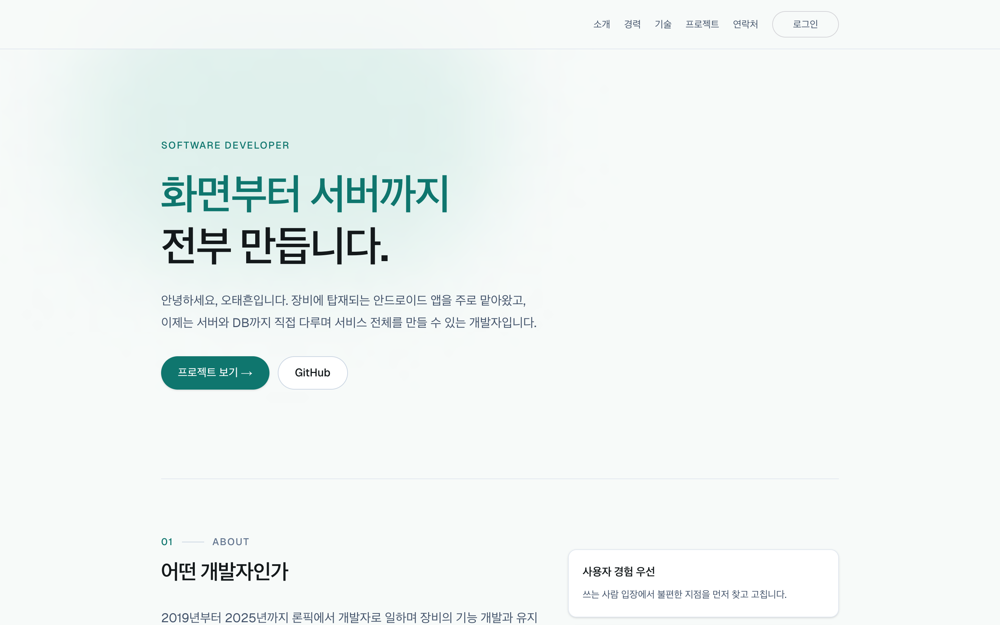 | 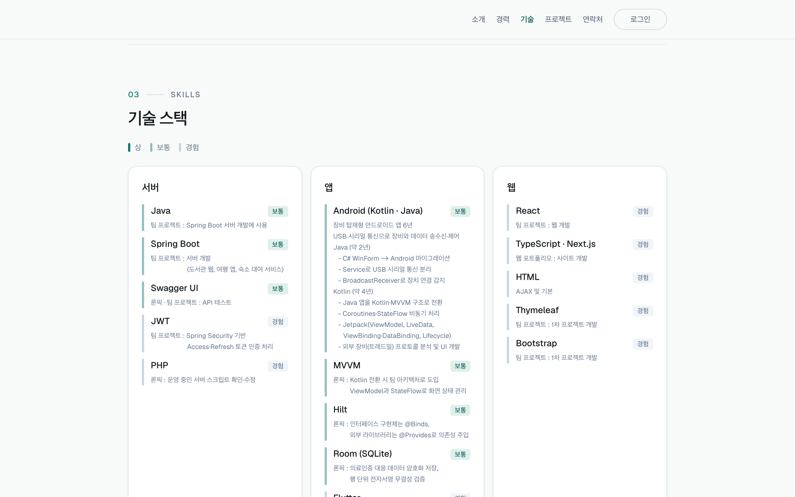 |
| 상단 고정 네비, 스크롤 위치에 따라 **현재 섹션 강조** | 분야별 카드, 숙련도(상 · 보통 · 경험)를 **왼쪽 선 색**으로 구분 + 사용 근거 표시 |

### 프로젝트

| 프로젝트 카드 목록 (가로 스크롤) | 프로젝트 상세 모달 | 상세 기록 (글) |
|:---:|:---:|:---:|
| 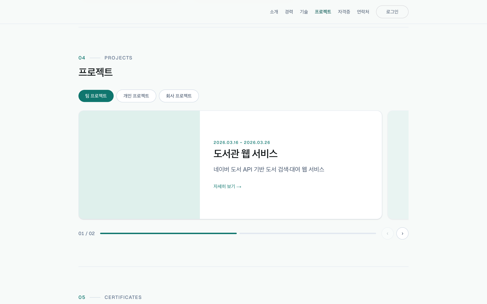 | 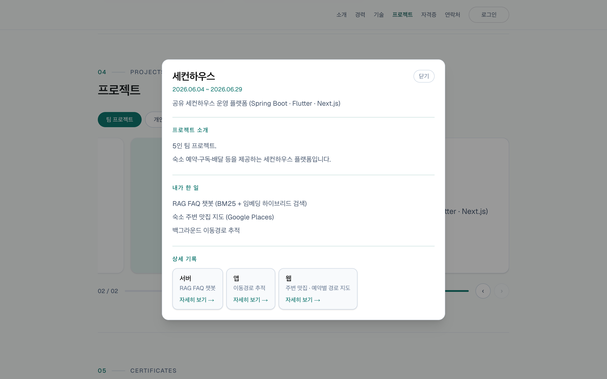 | 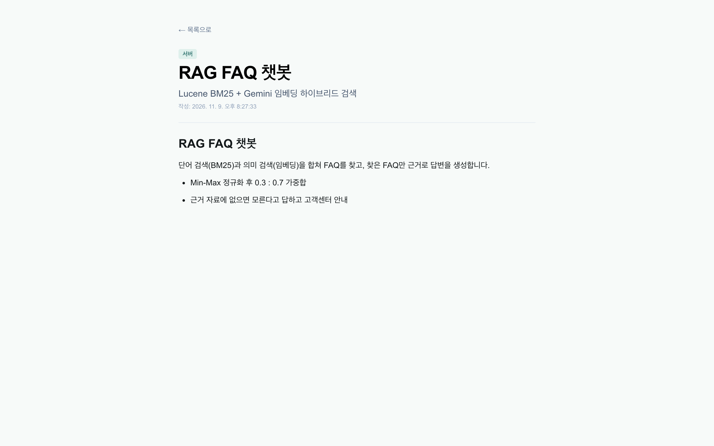 |
| 팀 / 개인 / 회사 탭, 한 장씩 넘기는 가로 스크롤 카드 + 인디케이터 | 프로젝트 소개 · 내가 한 일 · **파트별(웹/앱/서버) 상세 기록** 링크 | TipTap으로 작성한 본문을 읽기 전용으로 렌더 |

> 🔗 API: [`GET /api/{category}-groups`](#api-usage), [`GET /api/{category}-groups/{id}`](#api-usage), [`GET /api/{category}-projects/{id}`](#api-usage)

### 관리자

| 관리자 로그인 | 글 작성 · 수정 (TipTap) | 자격증 등록 |
|:---:|:---:|:---:|
| 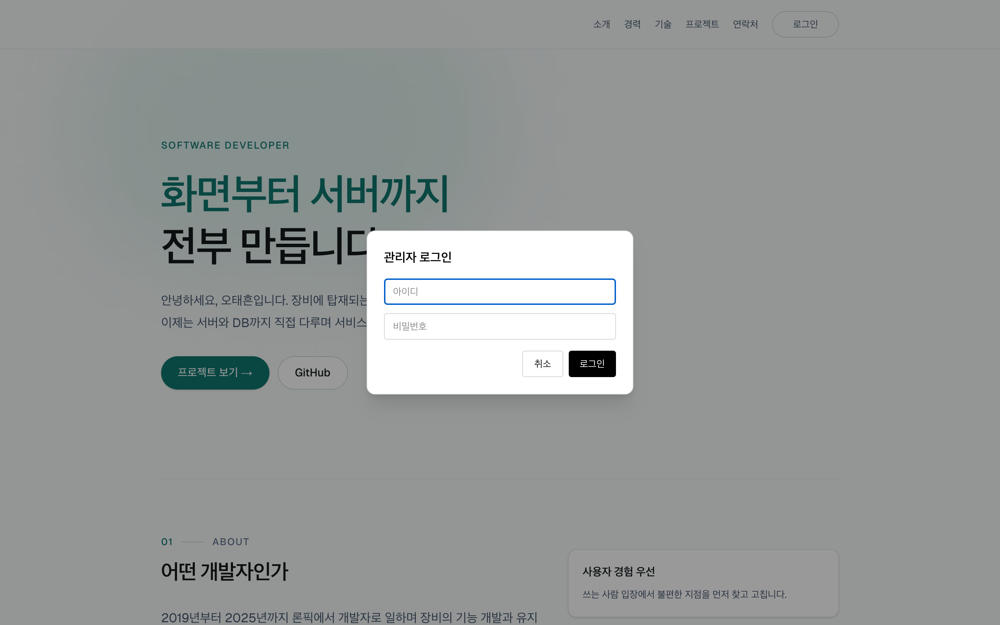 | 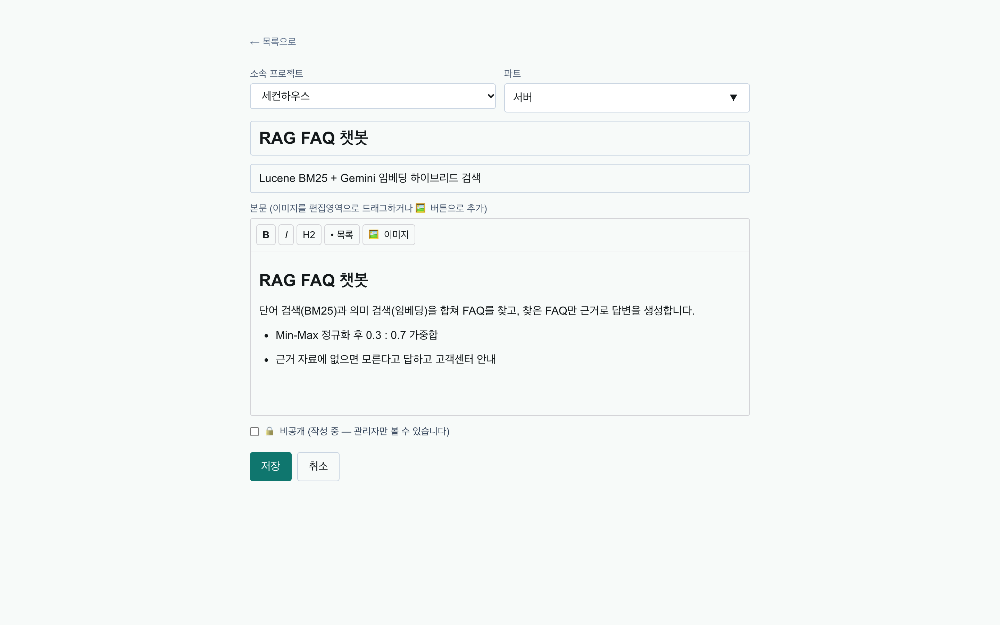 | 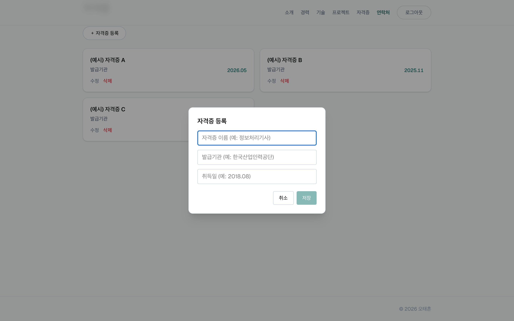 |
| `<dialog>` 모달 로그인, 로그인하면 등록 · 수정 · 삭제 버튼이 나타남 | 이미지를 **드래그 · 붙여넣기 · 버튼**으로 업로드해 원하는 위치에 삽입, 비공개(작성 중) 저장 | 모달 폼 하나로 등록과 수정을 같이 처리 |

> 🔗 API: [`POST /api/auth/login`](#api-usage), [`POST /api/images`](#api-usage), [`POST · PUT · DELETE /api/certificates`](#api-usage)

---

## 🛠 사용 기술 (Frontend)

| 구분 | 기술 |
|------|------|
| Web | **Next.js 16** (App Router), **React 19**, TypeScript |
| 스타일 | **Tailwind CSS 4**, CSS 변수 기반 색 토큰, Geist 폰트(`next/font`) |
| 상태 관리 | **React Context** (`AuthProvider`) — 로그인 상태 / 토큰 |
| 네트워크 | **axios** (응답 인터셉터로 401 · 403 처리) |
| 인증 | JWT (localStorage) + `loggedIn` 쿠키, **jwt-decode**로 만료 시각 확인 |
| 에디터 | **TipTap 3** (StarterKit, Image 확장) — 본문을 JSON으로 저장 |
| 애니메이션 | React `<ViewTransition>` (페이지 전환 · 제목 morph), CSS `@keyframes` (모달 등장) |
| 배포 | GitHub Actions, AWS EC2, Nginx, systemd |

---

## ✨ 담당 기능 (Frontend)

### 1. 원페이지 메인 · 스크롤 네비게이션
- 소개 · 경력 · 기술 · 프로젝트 · 자격증 · 연락처를 한 페이지에 두고, 상단 고정 네비에서 섹션으로 이동
- 화면 위에서 **40% 지점에 기준선**을 두고 그 선을 지난 마지막 섹션을 "지금 보는 섹션"으로 강조
- 마지막 섹션(연락처)은 짧아서 기준선까지 못 올라오므로 **바닥 근처에서 미리 강조**
- 좁은 화면에서는 경력 · 자격증 링크를 숨김, 자격증이 하나도 없으면 방문자에게는 섹션과 링크를 모두 숨김

### 2. 기술 스택 데이터 분리
- 기술 목록을 `skillsData.ts`에 분리해 화면 코드 수정 없이 내용만 바꿀 수 있게 함
- 숙련도를 **상 / 보통 / 경험** 3단계로 정의함

### 3. 프로젝트 (카테고리 · 그룹 · 글 3단 구조)
- **카테고리**(팀 / 개인 / 회사) → **그룹**(프로젝트 하나, 예: 1차 · 2차) → **글**(파트별 상세 기록, 예: 웹 · 앱 · 서버)
- 카테고리별 API 경로를 `projectConfig.ts` 한 곳에서 관리
- 가로 스크롤 카드 목록: 카드 폭을 92%로 잡아 **다음 장이 살짝 걸쳐 보이게** 하고, 화면 중앙에 가장 가까운 카드를 현재 카드로 계산
- 카드를 누르면 `<dialog>` 모달로 상세 표시, **세로로 긴 썸네일은 칸을 세로형으로 바꿔** 덜 잘리게 함
- 응답이 늦게 와도 이미 다른 카드를 열었으면 버리도록 `ignore` 플래그로 **경쟁 상태 방지**

### 4. 관리자 로그인 · 인증
- `AuthProvider`(Context)에서 로그인 상태와 `login` / `logout` / `getToken`을 앱 전체에 제공
- 서버 컴포넌트인 `layout.tsx`가 **쿠키(`loggedIn`)를 먼저 읽어** 초기 상태로 전달 → 첫 화면 로그인 버튼 깜빡임 방지
- axios 응답 인터셉터: 토큰을 실어 보낸 요청이 **401 · 403이면 자동 로그아웃** 후 메인으로 이동
- 토큰의 `exp`를 `jwt-decode`로 읽어 **만료 시각에 맞춰 타이머로 자동 로그아웃**
- 로그인하면 비공개 글 · 그룹까지 불러오고, 등록 · 수정 · 삭제 버튼과 "전체 보기"(관리자 목록)가 나타남

### 5. TipTap 에디터 · 이미지 업로드
- 툴바: 굵게 · 기울임 · H2 · 목록 · 이미지
- 이미지는 **드래그 앤 드롭**(마우스 좌표 → 문서 위치 `posAtCoords`로 변환), **붙여넣기**(커서 위치), **버튼 선택** 세 가지로 업로드
- 업로드 후 받은 URL로 ProseMirror 이미지 노드를 만들어 해당 위치에 삽입
- 본문은 `editor.getJSON()`을 문자열로 저장, 보기 화면은 같은 확장으로 **읽기 전용 에디터**(`ContentViewer`)로 렌더
- 예전 평문 데이터도 깨지지 않게 JSON 파싱 실패 시 평문으로 표시
- 글마다 **비공개(작성 중)** 체크 → 관리자에게만 보이고 🔒 배지 표시

### 6. 화면 전환 애니메이션
- `next.config.ts`에서 `experimental.viewTransition`을 켜고, 레이아웃 전체를 `<ViewTransition default="page-fade-slide">`로 감싸 **페이지 전환 시 페이드 + 슬라이드**
- 목록 페이지 제목은 `name`을 공유해 **앞으로 이동할 때만 morph**
- 모달은 `modal-pop` 클래스로 **배경 dim + 아래에서 올라오는 등장 애니메이션**
- `prefers-reduced-motion` 사용자는 애니메이션 제거

---

## 🔄 화면 흐름

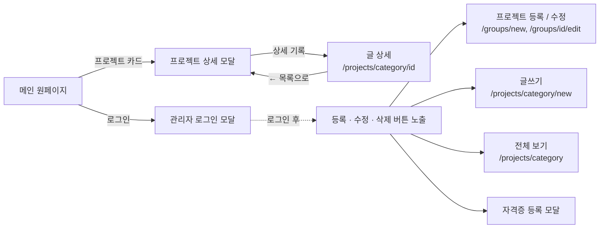

## 🏗 구조 (Next.js)

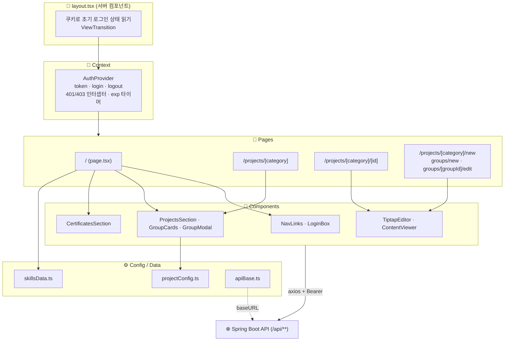

<a id="api-usage"></a>

## 📡 프론트에서 호출하는 API

> `{category}` = `team` · `personal` · `company` (예: `/api/team-groups`, `/api/personal-projects`)
> 인증 ✅ = `Authorization: Bearer {token}` 필수, 🔸 = 토큰이 있으면 비공개까지 응답

| 기능 | Method | URL | 인증 | 사용 화면 |
|------|--------|-----|:---:|------|
| 관리자 로그인 | POST | `/api/auth/login` | — | 로그인 모달 |
| 프로젝트(그룹) 목록 | GET | `/api/{category}-groups` | 🔸 | 메인 프로젝트 카드 목록, 전체 보기 |
| 프로젝트(그룹) 상세 + 글 목록 | GET | `/api/{category}-groups/{id}` | 🔸 | 프로젝트 모달, 프로젝트 수정 |
| 프로젝트 등록 | POST | `/api/{category}-groups` | ✅ | 프로젝트 등록 |
| 프로젝트 수정 | PUT | `/api/{category}-groups/{id}` | ✅ | 프로젝트 수정 |
| 프로젝트 삭제 (글은 남음) | DELETE | `/api/{category}-groups/{id}` | ✅ | 프로젝트 모달 |
| 글 목록 | GET | `/api/{category}-projects` | 🔸 | 전체 보기 (낱개 글) |
| 글 상세 | GET | `/api/{category}-projects/{id}` | 🔸 | 글 상세 |
| 글 작성 | POST | `/api/{category}-projects` | ✅ | 글쓰기 |
| 글 수정 | PUT | `/api/{category}-projects/{id}` | ✅ | 글 상세 (수정 모드) |
| 글 삭제 | DELETE | `/api/{category}-projects/{id}` | ✅ | 전체 보기 |
| 이미지 업로드 | POST | `/api/images` (multipart `file`) | ✅ | 에디터, 썸네일 |
| 자격증 목록 | GET | `/api/certificates` | — | 메인 자격증 섹션, 네비 |
| 자격증 등록 / 수정 / 삭제 | POST · PUT · DELETE | `/api/certificates`, `/api/certificates/{id}` | ✅ | 자격증 모달 |

> 요청 / 응답 예시는 [📡 API 명세 (Backend)](#api-spec) 참고

---

## 🐛 트러블슈팅 (Frontend)

| 문제 | 원인 | 해결 |
|------|------|------|
| 새로고침하면 로그인 상태인데도 "로그인" 버튼이 잠깐 보임 | 토큰이 localStorage에 있어 서버 렌더 시점엔 로그인 여부를 모름 | 로그인 시 `loggedIn` 쿠키도 저장, `layout.tsx`에서 쿠키를 읽어 초기 상태로 전달 |
| 토큰이 만료돼도 로그인 상태로 남아 있음 | 읽기 GET은 만료 토큰이어도 200으로 와서 401 인터셉터에 안 걸림 | `exp`를 읽어 **만료 시각에 타이머로 자동 로그아웃** |
| 위로 스크롤할 때 네비가 "프로젝트"를 건너뛰고 "기술"을 강조함 | IntersectionObserver 이벤트가 경계에서 몰리면 가운데 섹션이 씹힘 | 스크롤마다 **기준선(40%) 위치를 직접 계산**하는 방식으로 변경 |
| 다른 페이지에 갔다 오면 뒤로가기를 두 번 눌러야 함 | 네비 `#이동` · 탭 전환이 히스토리를 하나씩 쌓음 | `scrollIntoView` + `history.replaceState` |
| 모달에서 페이지 이동 시 모달 잔상이 남음 | `showModal()`한 `<dialog>`는 top layer에 있어 View Transition 스냅샷에 안 담김 | `Link`의 `onNavigate`에서 **이동 직전에 모달을 먼저 닫음** |
| 모달 내용이 짧을 때 휠을 굴리면 뒤 페이지가 스크롤됨 | 모달에 스크롤할 내용이 없으면 스크롤이 body로 넘어감 | 모달이 열린 동안 `body overflow: hidden`, 모달에 `overscroll-contain` |
| 다른 프로젝트 카드를 누르면 이전 내용이 잠깐 비침 | 받아온 데이터가 어느 그룹 것인지 구분하지 않음 | 응답을 **id와 함께 저장**해 현재 groupId와 같을 때만 표시 |
| 글 수정 후 저장해도 화면이 안 바뀜 | 보기 모드로 먼저 바꾸면 `ContentViewer`가 옛 content로 마운트됨 | **새 데이터를 받아 갱신한 뒤** 보기 모드로 전환 |
| 이미지를 연달아 넣으면 앞 이미지가 교체됨 | 삽입 직후 이미지가 선택된 상태로 남음 | 이미지 뒤에 **빈 문단을 함께 삽입**해 커서를 다음 줄로 이동 |
| "preloaded but not used" 경고 | 카드 목록이 클라이언트에서 늦게 그려져 preload가 쓰이지 않음 | `preload` 대신 첫 장만 `fetchPriority="high"` |
| 개발 환경에서 백엔드 이미지가 안 뜸 | Next 16부터 사설 IP(localhost) 이미지 최적화 차단(SSRF 방어) | 개발 환경에서만 `dangerouslyAllowLocalIP` 허용 |
| 트랙패드 가로 스와이프가 뒤로가기로 먹힘 | 카드 목록 끝에서 스크롤이 브라우저로 넘어감 | 카드 목록에 `overscroll-x-none` |

---

## 📂 주요 파일 (Frontend)

| 구분 | 파일 |
|------|------|
| 레이아웃 · 인증 | `app/layout.tsx`, `app/AuthProvider.tsx`, `app/LoginBox.tsx`, `app/apiBase.ts` |
| 메인 | `app/page.tsx`, `app/NavLinks.tsx`, `app/SectionLabel.tsx`, `app/skillsData.ts` |
| 프로젝트 | `app/ProjectsSection.tsx`, `app/projects/GroupCards.tsx`, `app/projects/GroupModal.tsx`, `app/projects/projectConfig.ts` |
| 프로젝트 페이지 | `app/projects/[category]/page.tsx`, `[id]/page.tsx`, `new/page.tsx`, `groups/new/page.tsx`, `groups/[groupId]/edit/page.tsx` |
| 에디터 | `app/projects/TiptapEditor.tsx`, `app/projects/ContentViewer.tsx` |
| 자격증 | `app/CertificatesSection.tsx` |
| 스타일 · 설정 | `app/globals.css`(색 토큰 · 전환 애니메이션 · 에디터 스타일), `next.config.ts`, `.github/workflows/deploy.yml` |

---

<a id="backend"></a>

## 🖥 백엔드 (Spring Boot)

> 포트폴리오의 **글 · 프로젝트 그룹 · 자격증 · 이미지 · 관리자 인증**을 담당하는 REST API 서버
> 백엔드 저장소: [joldoPortfolio-server](https://github.com/JOLDO/joldoPortfolio-server)

### 🛠 사용 기술 (Backend)

| 구분 | 기술 |
|------|------|
| Backend | Java 17, Spring Boot 4.1 |
| ORM | Spring Data JPA (Hibernate) — 쿼리 메서드 방식 |
| 인증 | Spring Security + **JWT** (jjwt 0.12, HS256) |
| Database | MariaDB |
| API 문서 | Swagger (springdoc-openapi 3.0) |
| 배포 | AWS EC2 · RDS(MariaDB) · Nginx · systemd · GitHub Actions |
| 기타 | Lombok, Gradle |

### ✨ 담당 기능 (Backend)

#### 1. 카테고리별 프로젝트 글 CRUD
- 팀 / 개인 / 회사 3개 카테고리를 **컨트롤러 하나로 처리**: 경로를 `/{category:team|personal|company}-projects`로 정규식 제한 → 그 외 값은 404
- 카테고리는 요청 body가 아니라 **URL 경로에서 받아 저장**
- 본문(`content`)은 TipTap 에디터의 **JSON 문서를 문자열 그대로 LONGTEXT에 저장** (서버는 내용을 해석하지 않음)
- 목록 응답은 본문을 뺀 가벼운 DTO(`ProjectSummaryResponse`), 상세에서만 본문 포함(`ProjectDetailResponse`)

#### 2. 공개 / 비공개 (작성 중)
- 글 · 그룹에 `published` 컬럼 → 방문자에게는 공개된 것만, **관리자(ADMIN)로 로그인하면 비공개 포함 전체** 조회
- 같은 GET API에서 `request.isUserInRole("ADMIN")`으로 분기 → 방문자가 비공개 글 상세에 접근하면 404
- 컬럼 추가 시 기존 데이터가 깨지지 않도록 `default true`, 요청에 값이 없으면 공개로 처리

#### 3. 프로젝트 그룹 (예: 팀 1차 / 2차, 회사 미플)
- 글 여러 개를 하나로 묶는 `project_group` 테이블, 글은 `groupId` + `part`(웹 / 앱 / 서버 등)로 소속 표시
- 그룹 목록(카드용) / 그룹 상세(모달용: 그룹 설명 + 맡은 일 + 소속 글 목록) API
- 그룹 상세에 딸린 글 목록은 본문 제외, **오래된 순으로 고정**해 파트 순서가 흔들리지 않게 함
- **그룹을 삭제해도 글은 지우지 않고 `groupId` / `part`만 비움** (실수로 그룹을 지워도 글이 사라지지 않게)
- 연관관계(`@ManyToOne`) 대신 id만 저장 — 글 조회 시 그룹까지 같이 읽을 필요가 없어서

#### 4. 자격증 CRUD
- 이름 · 발급기관 · 취득일, 취득일은 `"2018.08"` 형식 문자열로 저장하고 그 값으로 최신순 정렬

#### 5. 이미지 업로드
- 에디터에서 올린 이미지를 서버 로컬 디스크(`uploads/`)에 저장하고 **절대 URL을 반환** → 에디터가 본문에 삽입
- 파일명은 **UUID**로 바꿔 중복 방지, 확장자 화이트리스트(png / jpg / jpeg / gif / webp / svg), 저장 경로가 업로드 폴더 밖으로 나가지 않는지 검사(**경로 조작 방지**)
- 최대 10MB, `/uploads/**`는 Security 필터를 아예 거치지 않는 정적 리소스로 제공

#### 6. 관리자 인증 (JWT)
- 회원가입 없음 → **서버 첫 실행 시 관리자 계정 1개를 자동 생성**(`DataInitializer`), 비밀번호는 BCrypt 해시로 저장
- 로그인 성공 시 JWT 발급(유효 1시간), 이후 요청의 `Authorization: Bearer` 헤더를 `JwtAuthenticationFilter`가 검증
- 권한 규칙: **GET은 누구나, 등록 · 수정 · 삭제(POST / PUT / DELETE)는 ADMIN만** — `SecurityConfig`에서 일괄 적용
- 세션 없이 STATELESS, CSRF 비활성화(토큰을 헤더로 보내므로), CORS 허용 도메인은 설정 파일로 분리
- DB 비밀번호 · JWT 키 · 관리자 계정은 git에 안 올라가는 `application-secret.properties`로 분리, `.example` 파일 제공

<a id="api-spec"></a>

### 📡 API 명세

| 기능 | Method | URL | 인증 | 사용 화면 |
|------|--------|-----|:---:|------|
| 관리자 로그인 | POST | `/api/auth/login` | — | 로그인 모달 |
| 글 목록 | GET | `/api/{category}-projects` | — (관리자면 비공개 포함) | 전체 보기 |
| 글 상세 | GET | `/api/{category}-projects/{id}` | — (관리자면 비공개 포함) | 글 상세 |
| 글 작성 | POST | `/api/{category}-projects` | ADMIN | 글쓰기 |
| 글 수정 | PUT | `/api/{category}-projects/{id}` | ADMIN | 글 상세 (수정 모드) |
| 글 삭제 | DELETE | `/api/{category}-projects/{id}` | ADMIN | 전체 보기 |
| 그룹 목록 | GET | `/api/{category}-groups` | — | 메인 프로젝트 카드 목록 |
| 그룹 상세 (+소속 글) | GET | `/api/{category}-groups/{id}` | — | 프로젝트 모달 |
| 그룹 생성 / 수정 / 삭제 | POST / PUT / DELETE | `/api/{category}-groups[/{id}]` | ADMIN | 프로젝트 등록 · 수정 |
| 자격증 목록 | GET | `/api/certificates` | — | 자격증 섹션 |
| 자격증 등록 / 수정 / 삭제 | POST / PUT / DELETE | `/api/certificates[/{id}]` | ADMIN | 자격증 모달 |
| 이미지 업로드 | POST (multipart `file`) | `/api/images` | ADMIN | 에디터, 썸네일 |

> `{category}` = `team` | `personal` | `company`

<details>
<summary>요청 / 응답 예시</summary>

**관리자 로그인**
```
POST /api/auth/login
{ "username": "admin", "password": "****" }
```
```json
{ "token": "eyJ...", "tokenType": "Bearer", "expiresInMs": 3600000 }
```

**글 작성**
```
POST /api/team-projects
Authorization: Bearer {token}
```
```json
{ "groupId": 1, "part": "서버", "title": "...", "summary": "...",
  "content": "{\"type\":\"doc\",\"content\":[...]}", "thumbnailUrl": "...", "published": false }
```
```
→ 201 { "id": 5, "groupId": 1, "part": "서버", "title": "...", ..., "published": false, "createdAt": "...", "updatedAt": "..." }
```

**그룹 상세**
```
GET /api/team-groups/1
```
```json
{ "id": 1, "name": "1차 프로젝트", "summary": "...", "description": "...", "contribution": "...",
  "period": "2026.03 ~ 2026.03", "thumbnailUrl": "...", "published": true,
  "posts": [ { "id": 5, "part": "서버", "title": "...", "summary": "...", "published": true } ] }
```

**이미지 업로드**
```
POST /api/images  (multipart/form-data, file=...)
```
```json
{ "url": "http://{host}/uploads/3f2a...-uuid.png" }
```
</details>

<a id="auth-flow"></a>

### 🔐 인증 · 권한 흐름

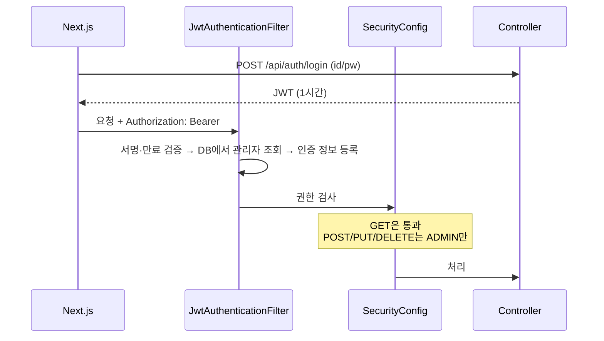

<a id="upload-flow"></a>

### 🖼 이미지 업로드 흐름

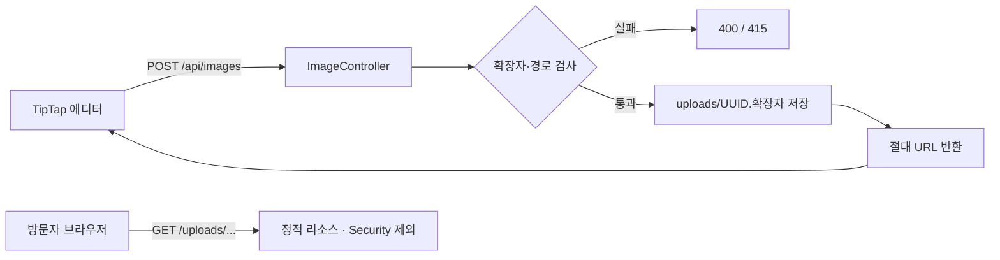

### 🗄 DB 관계

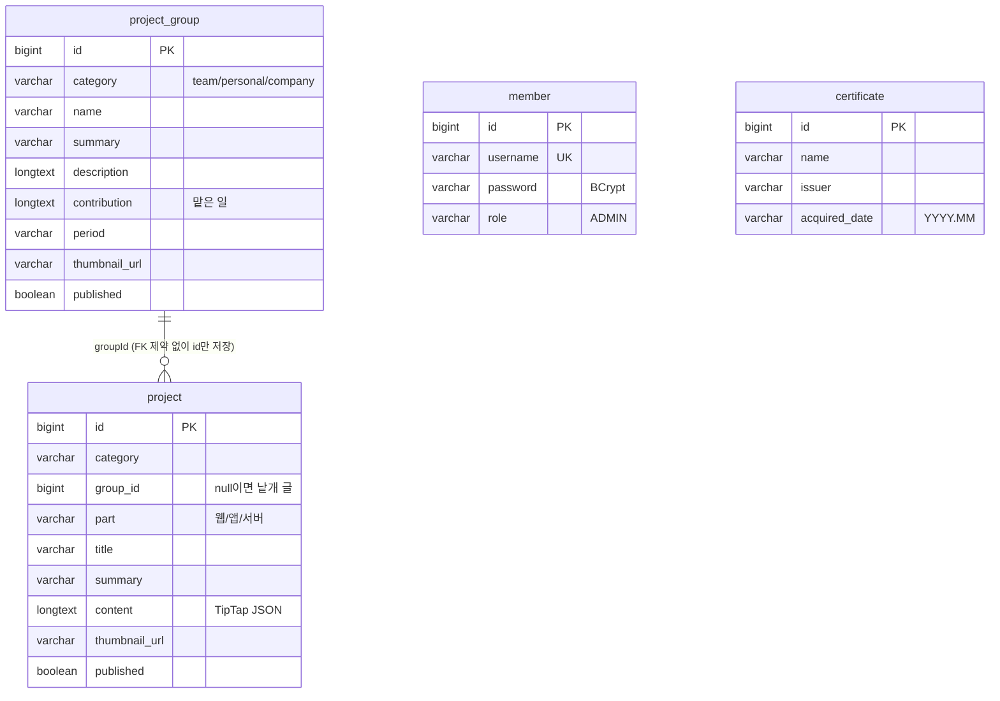

- 모든 테이블에 `created_at` / `updated_at`이 있고 `@PrePersist` · `@PreUpdate`로 자동 기록
- 그룹과 글은 FK 제약 없이 **id만 저장** → 그룹을 지워도 글은 남고 `group_id`만 비워짐

<a id="backend-trouble"></a>

### 🐛 트러블슈팅 (Backend · 배포)

| 문제 | 원인 | 해결 |
|------|------|------|
| 없는 글 요청(404)이나 인증 실패(401)가 전부 403으로 응답됨 | 예외 발생 시 Spring이 `/error`로 내부 재요청하는데, 이 요청도 Security 필터의 "ADMIN만" 규칙에 막힘 | `DispatcherType.ERROR` 요청은 permitAll → 원래 상태 코드가 그대로 전달됨 |
| 배포 후 업로드 이미지 URL이 `http://localhost:8080/uploads/...`로 만들어져 깨짐 | Nginx 뒤에서는 Spring이 요청을 localhost에서 온 것으로 인식 | `server.forward-headers-strategy=framework` + Nginx에서 `X-Forwarded-*` 헤더 전달 |
| RDS 연결 시 앱이 시작되지 않음 ("insecure transport are prohibited") | RDS가 SSL 연결만 허용(`require_secure_transport=ON`) | JDBC URL에 `?sslMode=trust` 추가 |
| GitHub Actions에서 EC2 SSH 접속 타임아웃 | 보안 그룹 SSH 허용 범위가 내 IP로만 되어 있음 | GitHub 러너가 접속할 수 있도록 SSH 허용 범위 수정 |

### 📂 주요 파일 (Backend)

| 계층 | 파일 |
|------|------|
| Controller | `ProjectController`, `ProjectGroupController`, `CertificateController`, `ImageController`, `AuthController` |
| Service | `ProjectService`, `ProjectGroupService`, `CertificateService`, `ImageStorageService`, `AuthService` |
| Security | `SecurityConfig`, `JwtService`, `JwtAuthenticationFilter`, `CustomUserDetailsService` |
| Config | `WebConfig`(업로드 정적 리소스), `DataInitializer`(관리자 계정 생성) |
| Entity | `Project`, `ProjectGroup`, `Certificate`, `Member` |
| Repository | `ProjectRepository`, `ProjectGroupRepository`, `CertificateRepository`, `MemberRepository` (JPA 쿼리 메서드) |
| DTO (record) | `ProjectRequest` / `ProjectSummaryResponse` / `ProjectDetailResponse`, `ProjectGroupRequest` / `ProjectGroupSummaryResponse` / `ProjectGroupDetailResponse`, `CertificateRequest` / `CertificateResponse`, `LoginRequest` / `LoginResponse` |
| 배포 | `.github/workflows/deploy.yml` |

---

<a id="deploy"></a>

## 🚀 배포

> 2026.07 AWS에 배포했으나, 현재는 **AWS 프리티어 기간 만료로 서버 종료**

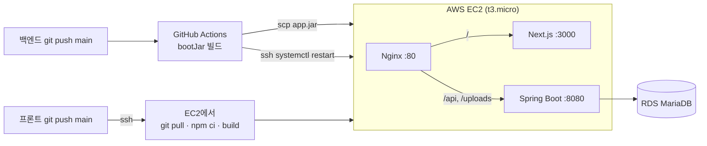

- 프론트와 백엔드를 **EC2 한 대에 systemd 서비스로 실행**, Nginx가 경로로 나눠 전달(리버스 프록시)
- 같은 주소(오리진)라 운영에서는 **CORS 설정이 필요 없음** → 프론트는 `NEXT_PUBLIC_API_BASE`를 비워 둠
- 프론트: `main` push → GitHub Actions가 EC2에 SSH 접속해 `git pull → npm ci → npm run build → systemctl restart`
- 백엔드: `main` push → GitHub Actions가 `bootJar` 빌드 후 jar를 EC2로 복사하고 서비스 재시작
- t3.micro 메모리가 1GB라 빌드 중 메모리 부족에 대비해 **swap 2GB 추가**
- 개발에서는 `.env.development`의 `NEXT_PUBLIC_API_BASE=http://localhost:8080`으로 백엔드에 직접 요청

---

## ▶ 실행 방법

### 백엔드

```bash
git clone https://github.com/JOLDO/joldoPortfolio-server
cd joldoPortfolio-server
# 1. MariaDB 준비 (기본: localhost:3308 / portfolio-db) — application.properties에서 변경 가능
# 2. src/main/resources/application-secret.properties.example → application-secret.properties 복사 후 입력
#    spring.datasource.username / password, app.admin.username / password, app.jwt.secret(32자 이상)
# 3. 실행 (첫 실행 시 관리자 계정 자동 생성, 테이블은 ddl-auto=update로 자동 생성)
./gradlew bootRun
# Swagger: http://localhost:8080/swagger-ui.html
```

### 웹 (Next.js)

```bash
# 1. 백엔드 주소 설정 (.env* 파일은 git에 올라가지 않음)
echo "NEXT_PUBLIC_API_BASE=http://localhost:8080" > .env.development
# 2. 실행
npm install
npm run dev   # http://localhost:3000
```
